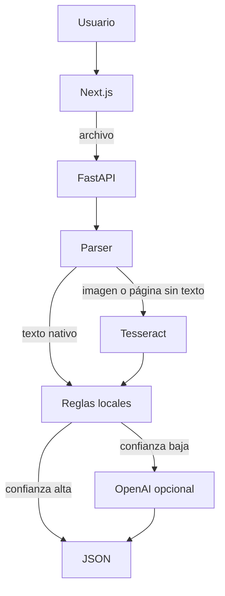

# Questionnaire Intelligence

Aplicación web para convertir un cuestionario en PDF, DOCX, XLSX o imagen en un JSON estable. Las reglas locales hacen la extracción. Tesseract lee las imágenes y los PDF sin texto. Un modelo con visión solo interviene cuando la estructura no es confiable y hay una clave configurada.

Para probarla: [https://questionnaire-platform-orc.vercel.app/](https://questionnaire-platform-orc.vercel.app/). Los documentos para subir están en `docs/examples/input`.

## Arquitectura



Frontend y backend se despliegan por separado. No hay base de datos, Redis ni cola. Cada solicitud se procesa en memoria y los archivos temporales no se conservan.

El detalle de capas está en [docs/architecture.md](docs/architecture.md). El contrato HTTP está en [docs/api-contract.md](docs/api-contract.md).

## Stack

| Pieza | Versión fijada |
| --- | --- |
| Python | 3.13 |
| FastAPI | 0.163.0 |
| Pydantic | 2.14.3 |
| Uvicorn | 0.54.0 |
| uv | 0.13.8 |
| Next.js | 16.4.6 |
| React | 19.3.0 |
| Bun | 1.4.4 |
| Tailwind CSS | 4.3.3 |

## Requisitos

- [uv](https://docs.astral.sh/uv/) y Python 3.13, que uv puede instalar.
- [Bun 1.4.4](https://bun.sh/).
- Docker, solo si quieres el entorno reproducible. Tesseract entra en la imagen del backend.
- Una clave de OpenAI solo si quieres el fallback. La aplicación extrae documentos claros sin ella.

## Instalación

```bash
cd backend
uv sync
copy .env.example .env
```

```bash
cd frontend
bun install
copy .env.example .env.local
```

En PowerShell, `copy` sustituye a `cp`.

## Variables de entorno

Backend, en `backend/.env`:

| Variable | Default | Uso |
| --- | --- | --- |
| `APP_ENV` | `development` | `production` rechaza `LLM_PROVIDER=mock` |
| `CORS_ORIGINS` | `http://localhost:3000` | Orígenes del navegador, separados por coma |
| `MAX_UPLOAD_SIZE_MB` | `15` | Tamaño máximo del archivo |
| `MAX_PDF_PAGES` | `100` | Tope de páginas |
| `REQUEST_TIMEOUT_SECONDS` | `90` | Tiempo total de una solicitud |
| `OPENAI_ENABLED` | `false` | El modelo queda apagado hasta verificar crédito |
| `OPENAI_API_KEY` | vacío | Solo en el backend. Nunca en `NEXT_PUBLIC_*` |
| `OPENAI_MODEL` | vacío | Modelo vigente con visión y salida estructurada |
| `OCR_ENABLED` | `true` | Si Tesseract no está instalado, el resto sigue funcionando |
| `LLM_PROVIDER` | `openai` | `mock` solo para Locust, nunca en producción |

Frontend:

```env
NEXT_PUBLIC_API_URL=http://127.0.0.1:8000/api/v1
```

Esa URL se incrusta en el bundle. En producción tiene que ser la URL pública del backend, no el nombre interno del contenedor. Si el valor usa `localhost`, el navegador lo cambia a `127.0.0.1`. Si `CORS_ORIGINS` incluye `localhost`, la API también acepta el mismo origen con `127.0.0.1`, y al revés.

## Ejecutar en local

```bash
cd backend
uv run uvicorn app.main:app --reload --host 127.0.0.1 --port 8000
```

```bash
cd frontend
bun run dev
```

La interfaz queda en `http://localhost:3000` y la API en `http://127.0.0.1:8000`. En Windows, `localhost` a veces apunta a IPv6 y el proceso solo escucha en IPv4. El navegador reescribe `localhost` a `127.0.0.1` antes de llamar a la API.

Páginas: inicio `/`, extracción `/extract`, resultados `/results`, rendimiento `/performance` y ajustes `/settings`. La zona de carga abre el selector al hacer clic. Los resultados muestran los ítems y el JSON. Desde ahí se copia el JSON, se descarga como `cuestionario.json` y las respuestas se descargan como `respuestas.pdf`. Extraer de nuevo repite el mismo archivo. Nueva extracción vuelve a la carga.

## Docker

Los límites de CPU y memoria del compose aplican en Docker Desktop. Un proveedor de hosting puede imponer otros.

```bash
docker compose up --build
docker compose up --build -d
docker compose logs -f
docker compose ps
docker compose down
```

Reconstruir solo el backend:

```bash
docker compose build backend
```

El 14 de noviembre de 2026 el stack se construyó y arrancó en esta máquina. `/api/v1/health` respondió `ok`. Dentro del contenedor, Tesseract 5.3.0 tiene español, inglés e italiano, y `/api/v1/documents/capabilities` reporta `ocr_available: true`. En Windows, fuera del contenedor, Tesseract no está instalado: una foto o un PDF escaneado no tienen texto que leer. Las imágenes usan usuario no root, Python slim y el runtime standalone de Next.js.

## Endpoints

| Método | Ruta | Qué hace |
| --- | --- | --- |
| `GET` | `/api/v1/health` | Estado y versión |
| `GET` | `/api/v1/documents/capabilities` | Formatos y límites reales |
| `POST` | `/api/v1/documents/extract` | Procesa un archivo |
| `GET` | `/api/v1/metrics` | Agregados de esta instancia |

```bash
curl -F "file=@docs/examples/input/sample_questionnaire_es.pdf" http://localhost:8000/api/v1/documents/extract
```

Campos opcionales del formulario: `use_llm=true|false` y `force_ocr=true|false`.

Formatos aceptados: `.pdf`, `.docx`, `.xlsx`, `.png`, `.jpg`, `.jpeg`, `.webp`. Cualquier otro, incluidos ejecutables, macros y archivos comprimidos sueltos, se rechaza. El límite inicial es 15 MB, 100 páginas de PDF y 10 páginas de OCR.

## OCR y modelo

1. El parser lee el texto nativo.
2. Si la página o la imagen no tienen texto suficiente, entra Tesseract cuando está instalado.
3. Si la confianza heurística queda bajo 0.70, y `OPENAI_ENABLED`, la clave y el modelo están definidos, se hace como máximo una llamada.
4. Si el modelo falla o no hay saldo, se conserva el resultado determinístico y la respuesta queda en `partial`.
5. Si no había ítems y el modelo era imprescindible, la API responde `422` o `503`. Nunca inventa preguntas ni la respuesta correcta.

La suscripción de ChatGPT no es crédito de la API. No actives recargas automáticas. El modelo se elige con `OPENAI_MODEL`; en noviembre de 2026 `gpt-6-luna` está disponible en la API, acepta imagen y salida estructurada, y es el más barato de esa generación.

## Tests

```bash
cd backend
uv run pytest
uv run ruff check app tests
```

La suite local reúne 54 tests. No llama a OpenAI ni necesita red: el proveedor se sustituye y Tesseract real se omite si no está instalado.

## Locust

```bash
cd backend
uv run --group load locust -f ../load-tests/locustfile.py DeterministicUser --host http://localhost:8000 --headless -u 5 -r 5 -t 60s
```

Clases: `DeterministicUser`, `OcrUser`, `LlmMockUser`, `MixedUser`. `LlmMockUser` solo con `LLM_PROVIDER=mock`. No lances carga contra la API real de OpenAI.

Medición local del 14 de noviembre de 2026, Windows, PDF sintético en español, `use_llm=false`, proceso ya caliente:

| Usuarios | Duración | Requests | Fallos | p50 | p95 | p99 | req/s |
| --- | --- | --- | --- | --- | --- | --- | --- |
| 5 | 20 s | 157 | 0 | 43 ms | 140 ms | 250 ms | 8.91 |

Una solicitud en frío del mismo PDF tardó 529 ms y devolvió 5 ítems sin usar el modelo. No hay medición de OCR real ni de llamadas de pago en esta tabla.

## Ejemplos

Los cuestionarios para probar la aplicación, en local o en la URL publicada, están en `docs/examples/input`. Ahí hay PDF, Word, Excel, fotos y escaneos. Cada archivo se sube desde Extracción.

| Entrada | Salida |
| --- | --- |
| `docs/examples/input/sample_questionnaire_es.pdf` | `docs/examples/output/sample_questionnaire_es.json` |
| `docs/examples/input/sample_questionnaire_it.docx` | `docs/examples/output/sample_questionnaire_it.json` |
| `docs/examples/input/sample_questionnaire_en.xlsx` | `docs/examples/output/sample_questionnaire_en.json` |
| `docs/examples/input/sample_questionnaire_photo.jpg` | `docs/examples/output/sample_questionnaire_photo.json` |

`docs/examples/cases.json` describe el resto del corpus: texto determinístico, un PDF de baja confianza que debe llamar al modelo, fotos y PDF escaneados para OCR, y dos casos cortos que combinan OCR y modelo. Son cuestionarios inventados. El JSON de la foto corresponde al texto impreso en la imagen; no es el resultado de un OCR en vivo.

## Limitaciones

- La confianza es una heurística, no una probabilidad calibrada.
- Escritura manuscrita, sombras y perspectiva fuerte dependen del modelo y no tienen precisión garantizada.
- Las métricas son de un solo proceso y se borran al reiniciar.
- `asyncio.wait_for` responde 504, pero el hilo del parser termina por su cuenta. Los límites de páginas y píxeles contienen ese trabajo.
- Un bloque de emparejamiento usa `valor` numérico a la izquierda y letra a la derecha. La clave, si existe, va como `1-A,2-B`.
- Si el idioma no se puede decidir, el código es `und`.
